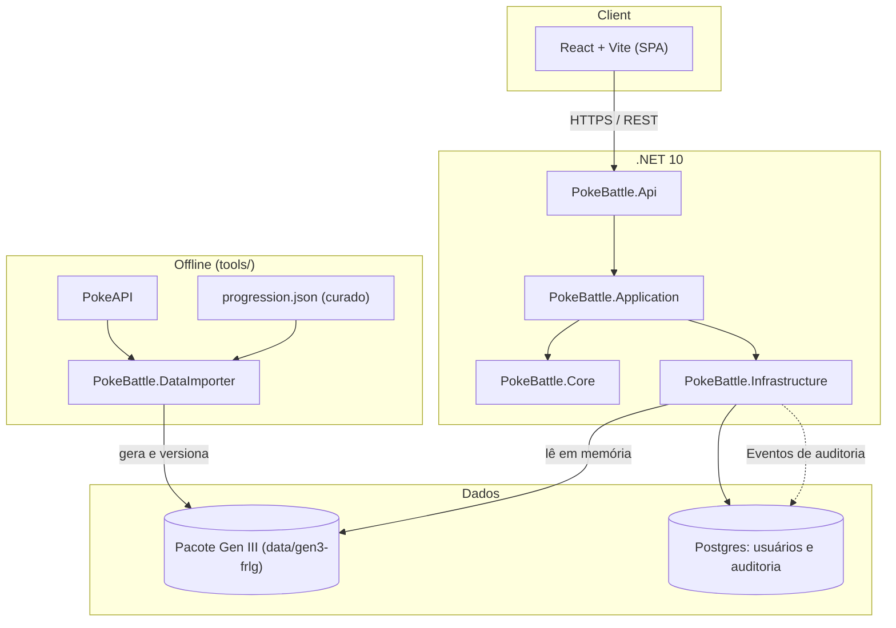
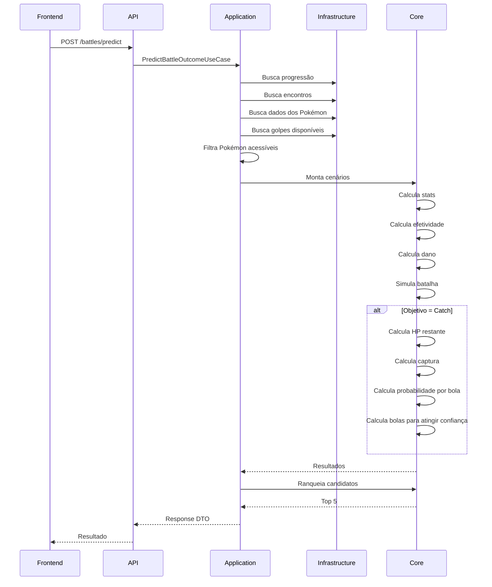
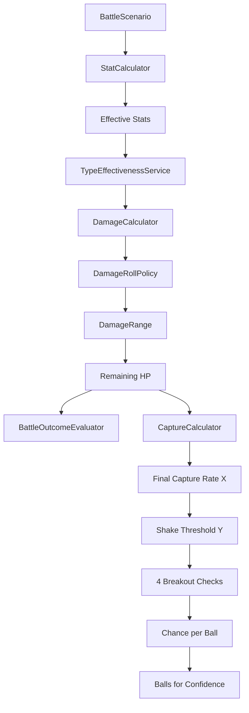
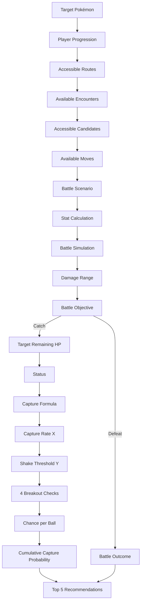

# Arquitetura — PokeBattle Predictor

## 1. Visão geral

O PokeBattle Predictor recomenda até **5 Pokémon** para enfrentar um Pokémon-alvo em **Pokémon FireRed / LeafGreen**, usando as mecânicas da **Geração III**.

O sistema não busca o Pokémon "mais forte". Ele responde:

> Qual Pokémon que o jogador consegue obter neste ponto do jogo oferece a melhor condição para cumprir o objetivo escolhido?

Objetivos iniciais:
- **Defeat** — derrotar o alvo
- **Catch** — capturar o alvo

Fatores considerados: progressão do jogador, rotas alcançadas, Pokémon disponíveis, níveis possíveis dos encontros, golpes disponíveis naquele momento, tipos, STAB, stats, Nature, IVs, EVs, habilidades, dano, RNG, críticos, HP restante, status, Poké Ball, taxa de captura e probabilidade real de captura.

A resposta final apresenta até 5 candidatos ranqueados, do mais ao menos favorável.

## 2. Escopo da V1

- FireRed / LeafGreen, mecânicas da Gen III
- Encontros selvagens, progressão do jogador, Pokémon por rota
- Golpes disponíveis conforme a progressão
- Simulação de batalha, objetivos Defeat e Catch
- Cenários pessimista, neutro e otimista
- Faixa de dano, probabilidade de captura, ranking dos melhores candidatos

Ginásios, treinadores e outros tipos de batalha entram depois (ver `roadmap.md`).

## 3. Princípios

Clean Architecture, SOLID, DRY, KISS e YAGNI.

`PokeBattle.Core` **não** depende de ASP.NET, EF Core, banco, HTTP, PokeAPI, filesystem ou serviços externos. Todo cálculo deve poder ser executado e testado isoladamente.

## 4. Arquitetura geral



## 5. Camadas

### 5.1 PokeBattle.Core
Regras de domínio e cálculos. Não conhece a origem dos dados.

- `BattleScenario`, `BattleObjective`, `DamageRollPolicy`, `CriticalHitPolicy`
- `StatCalculator`, `TypeEffectivenessService`, `DamageCalculator`
- `BattleSimulationService`, `BattleOutcomeEvaluator`, `BattleRankingService`
- `CaptureCalculator`, `CaptureProbabilityCalculator`

### 5.2 PokeBattle.Application
Orquestração (ex: `PredictBattleOutcomeUseCase`): recebe a solicitação, valida o objetivo, identifica a progressão, encontra e filtra Pokémon acessíveis, determina níveis e golpes possíveis, busca dados, monta cenários, executa simulações, ranqueia e retorna os 5 melhores.

### 5.3 PokeBattle.Infrastructure
Leitura do pacote de dados Gen III (espécies, golpes, encontros, progressão, disponibilidade de golpes), banco, persistência, autenticação e auditoria. A normalização Gen III acontece no `DataImporter`, antes de o dado ser gravado.

### 5.4 PokeBattle.Api
Endpoints, validação de requests, autenticação, DTOs, serialização e códigos HTTP.

## 6. Fluxo principal



## 7. Progressão do jogador

Disponibilidade é uma **restrição obrigatória**. O sistema nunca recomenda um Pokémon só porque o matchup é excelente.

```
Progressão do jogador → Pokémon disponíveis → Filtrar inacessíveis → Simular apenas candidatos válidos

Excelente matchup + Inacessível = Não pode ser recomendado
```

## 8. Dados do jogo

Os dados do jogo são estáticos e ficam num **pacote de dados Gen III versionado no repositório** (`data/gen3-frlg/`), gerado por `tools/PokeBattle.DataImporter`. A API **não** chama a PokeAPI em runtime.

- **Vem da PokeAPI (importado e normalizado):** espécies, base stats, tipos, habilidades, golpes, learnsets (`version_group = firered-leafgreen`) e encontros por área. A PokeAPI traz, por slot de encontro e versão, `method`, `min_level`, `max_level` e `chance`.
- **Curado à mão (`data/curated/progression.json`):** ordem de progressão das áreas, requisitos de cada área (insígnia, HM, item), presentes/estáticos/trocas e ponto de obtenção de cada TM/HM.

```
RouteEncounters    Route, Pokemon, EncounterMethod, MinLevel, MaxLevel, Chance, Version
RouteLevelRanges   derivado de RouteEncounters
MoveAvailability   Pokemon, Move, Method, RequiredLevel, RequiredProgress
```

- `EncounterMethod`: Grass, Surf, OldRod, GoodRod, SuperRod, Gift, Static, Trade (a V1 implementa só o necessário para selvagens)
- `Method` de golpe: LevelUp, TM, HM, Egg, Tutor
- O sistema considera o que o jogador poderia ter **naquele momento**, não o learnset completo

### Normalização Gen III

A PokeAPI devolve dados modernos. Antes de chegar ao `Core`, todo dado passa pelo normalizador:

- `damage_class` é ignorado (ex.: `bite` vem Physical; na Gen III Dark é especial); categoria vem da tabela tipo → categoria
- `past_values` (golpes), `past_types` e `past_abilities` aplicados pelo version group/geração
- hidden abilities descartadas
- base stats alterados na Gen VI corrigidos (por `past_stats`, se a API expuser, ou tabela de overrides)

## 9. BattleObjective

```csharp
public enum BattleObjective { Defeat, Catch }
```

- **Defeat**: maximiza a favorabilidade para derrotar o alvo
- **Catch**: cria condição favorável para capturar sem derrotar acidentalmente

## 10. BattleScenario e RNG são conceitos separados

```csharp
public sealed record SideProfile(NatureProfile Nature, IvProfile Iv, EvProfile Ev, LevelProfile Level);
public sealed record BattleScenario(ScenarioKind Kind, SideProfile Candidate, SideProfile Opponent);
```

O `ScenarioResolver` aplica o cenário a um `BattlerSpec` (base stats, tipos e cada atributo incerto com seu `DataSource`) e devolve um `ResolvedBattler` (nível, HP máximo e o `Combatant` usado pelo cálculo de dano). Só atributos `Estimated` recebem o valor do cenário. Os valores concretos ficam num único lugar, o `ScenarioCatalog`, e as decisões estão em `decisoes-cenarios.md`.

Cenários da V1: **Pessimista, Neutro, Otimista**. O cenário descreve *quais condições estamos assumindo*; o RNG é avaliado por `DamageRollPolicy` (*como estamos avaliando a variância*). O cenário **não** carrega um valor arbitrário de RNG.

```
BattleScenario + DamageRollPolicy + CriticalHitPolicy → Battle Simulation → Damage Result
```

Isso permite `Neutro + FullRange` ou `Pessimista + Minimum` sem misturar responsabilidades.

### DamageRollPolicy

```csharp
public enum DamageRollPolicy { Minimum, Average, Maximum, FullRange }
```

- `Minimum` / `Maximum`: menor / maior dano possível
- `Average`: média respeitando a distribuição real da Gen III (random inteiro 85–100)
- `FullRange`: devolve `Damage_min ≤ Damage ≤ Damage_max` (ex: 79–81 de 100 HP → 79%–81%)

### CriticalHitPolicy

```csharp
public enum CriticalHitPolicy { Never, Normal, Guaranteed, EvaluateProbability }
```

Crítico é tratado separadamente do RNG de dano, seguindo as regras da Gen III.

### Faixa de dano não é probabilidade de vitória

`79–81` significa que o ataque pode causar 79, 80 ou 81 de dano. **Não** significa 80% de chance de vitória; isso depende da sequência completa da batalha.

## 11. Stats

- **Nature**: `+10%` (1.1), `0%` (1.0) ou `-10%` (0.9) em um stat. **HP não é afetado.**
- **IVs**: `[0, 31]`, com perfis Low / Average / High / Maximum. Valores concretos em `decisoes-cenarios.md` §2 (em revisão; provisório 8 / 15 / 23 / 31).
- **EVs**: perfis na V1; EVs reais do usuário no futuro. Contribuição: `floor(EV / 4)`.

```
HP    = floor(((2B + IV + floor(EV/4)) × L) / 100) + L + 10
Stat  = floor((floor(((2B + IV + floor(EV/4)) × L) / 100) + 5) × Nature)
```

Respeitar a ordem das operações e os truncamentos da Gen III.

## 12. Tipos e STAB

- `TypeEffectivenessService` usa a tabela da Gen III (sem Fairy)
- STAB = 1.5 quando o tipo do golpe coincide com o tipo do Pokémon

## 13. DamageCalculator e fórmula de dano

Entrada: Attacker, Defender (stats já calculados, ver `Combatant`), Move, DamageRollPolicy, CriticalHitPolicy. O cenário monta os stats antes; o `DamageCalculator` não conhece o cenário.

Ordem real das operações, conferida na decompilação do FireRed (`pret/pokefirered`: `CalculateBaseDamage` em `src/pokemon.c`; `Cmd_damagecalc`, `Cmd_typecalc` e `ApplyRandomDmgMultiplier` em `src/battle_script_commands.c`). Tudo em inteiros, truncando a cada passo:

```
1. Base     d = A × Power
            d = d × (2×L/5 + 2)            (2×L/5 já truncado)
            d = d / D
            d = d / 50
            se físico e d = 0 → d = 1       (só o ramo físico tem esse piso)
            d = d + 2
2. Crítico  d = d × 2                       (chance 1/16; golpe de crítico alto 1/8)
3. STAB     d = d × 15 / 10
4. Tipo     para cada entrada da tabela gTypeEffectiveness, NA ORDEM DA TABELA, que casa com um tipo do defensor:
            d = d × mult / 10   (mult 20, 5 ou 0); se d = 0 e mult ≠ 0 → d = 1
5. Random   se d ≠ 0: d = d × (85..100) / 100; se d = 0 → d = 1
```

Onde `A` = Attack/Sp. Attack e `D` = Defense/Sp. Defense, escolhidos pela categoria do **tipo** do golpe. A ordem da tabela importa no passo 4: contra tipo duplo com 2x e 0.5x, o truncamento depende de qual entrada vem primeiro (ex.: Ice contra Fire/Flying aplica Flying antes de Fire). Quais modificadores estão ativos em cada fase está em `fases.md`.

## 14. Simulação, avaliação e ranking

`BattleSimulationService` combina Stats + Move + Type + Scenario + DamageRollPolicy + CriticalHitPolicy e produz `Damage`, `DamageRange`, `RemainingHP`, `TurnsToKO`, `Outcome`.

`BattleOutcomeEvaluator` classifica: Guaranteed KO, Possible KO, 2HKO, 3HKO, Unfavorable, Balanced, Favorable. A classificação **não substitui** os valores numéricos.

`BattleRankingService`:

```
Defeat:  Accessibility → Matchup → Damage → Survivability → Turns to KO → Consistency
Catch:   Accessibility → Ability to reduce HP safely → Status availability
         → Capture probability → KO risk → Required balls
```



## 15. Captura (domínio próprio)

Captura **não** é resultado secundário de batalha: dano e probabilidade de captura são problemas matemáticos diferentes.

```
X = ((3M − 2H) × (C × B) / (3M)) × S        M = HP máx, H = HP atual, C = Capture Rate, B = Ball Bonus, S = Status
Se X < 1 → X = 1.   Se X ≥ 255 → captura garantida.

Y = 1048560 / sqrt(sqrt(16711680 / X))      (aproximação: 65535 / sqrt(sqrt(255 / X)))

P_ball = (Y / 65536)^4                      (4 verificações de breakout)
```

- Implementar com **inteiros e truncamento em cada etapa**, não como equação contínua
- Usar o algoritmo real, não a aproximação `X/255`
- Ball Bonus: Poké Ball 1, Great Ball 1.5, Ultra Ball 2, Net Ball 3 (condicional)
- Status (S): Sleep/Freeze 2; Paralysis/Poison/Burn 1.5; nenhum 1

### Probabilidade acumulada

```
P(n bolas) = 1 − (1 − p)^n
n(q) = ceil( ln(1 − q) / ln(1 − p) )     para q = 50%, 90%, 95%, 99%
```

```csharp
public sealed record CaptureResult(
    int FinalCaptureRate, int ShakeThreshold, double ChancePerBall,
    int BallsFor50Percent, int BallsFor90Percent,
    int BallsFor95Percent, int BallsFor99Percent
);
```

Pode futuramente incluir `CurrentHp`, `MaxHp`, `Status`, `Ball`, `CatchRate` para o frontend explicar o resultado.

### Risco de KO

Para Catch, causar o máximo de dano não é desejável. Um candidato que deixa o alvo com 19–21 HP e arrisca KO no próximo golpe pode ser pior para captura do que outro que causa 35–40 de dano, mesmo sendo pior para derrotar.

## 16. Auditoria e persistência

- Auditoria na Application (o domínio não a conhece): `BattlePredictionRequested`, `BattlePredictionCompleted`, com User, Target, Objective, Progression, Candidates, Result, Timestamp
- Banco relacional (Postgres) só para dados de usuário: `Users`, `AuditLog`
- Dados do jogo ficam no pacote estático (seção 8), carregados em memória
- Futuro: `UserPokedex`, `UserPokemon`, `CustomMoveset`, `SavedBattle`, `SavedPrediction`
- Sem cache de PokeAPI em runtime, já que a API não a consulta

## 16.1 Containers e esteira

- Imagens: `api` (multi-stage `sdk:10.0` → `aspnet:10.0`, não-root, `HEALTHCHECK`, pacote de dados copiado), `web` (node → nginx, proxy `/api`), `db` (Postgres, a partir da auditoria)
- `docker-compose.yml` sobe o ambiente completo; override para desenvolvimento
- Health checks: `/health/live` e `/health/ready` (inclui banco quando houver)
- GitHub Actions: em PR roda format, build com warnings como erro, testes, gate de cobertura no `Core`, lint/typecheck do frontend, verificação do pacote de dados (`data-check`), build e scan das imagens, dependency review e CodeQL; em `main` publica as imagens no GHCR; deploy por tag, destino a definir
- Migrations do EF aplicadas por passo explícito, nunca no startup da API

## 17. Testabilidade

Todos os cálculos são determinísticos quando o RNG é controlado pela política de simulação.

- Dano: `DamageRollPolicy.Minimum` contra valor esperado da Gen III; `FullRange` valida mínimo e máximo
- Captura: `FinalCaptureRate`, `ShakeThreshold` e `ChancePerBall` contra valores derivados da implementação Gen III
- Múltiplas bolas: `CalculateBallsForConfidence(0.95)` contra valor esperado
- Progressão: Pokémon só disponível numa rota futura **não** entra nos candidatos
- Golpes: golpe que exige progressão superior **não** entra no moveset candidato

## 18. Decisões arquiteturais

1. **RNG separado do cenário.** Evita que "Pessimista" fique preso a "RNG mínimo".
2. **Sem precisão falsa.** Preferir `79%–81%` a `80.17%` quando o segundo não é uma probabilidade calculada. Distinguir "19,752% por bola" de "95% de chance acumulada em 14 bolas".
3. **Progressão como filtro.** Inacessível → descartar; acessível → simular → ranquear.
4. **Captura como domínio próprio** (`CaptureCalculator`, `CaptureProbabilityCalculator`).
5. **Sem microsserviço agora.** O isolamento do `Core` permite extrair o cálculo depois, sem pagar o custo operacional (contrato, deploy, latência) antes de existir motivo concreto.
6. **Dados do jogo como pacote estático.** Gerado offline a partir da PokeAPI e versionado. API determinística, sem dependência externa em produção, e mudança de dado sempre passa por PR.

## 19. Estrutura de projeto

```
src/
├── PokeBattle.Api/            Endpoints/, Contracts/, Program.cs
├── PokeBattle.Application/    Battles/PredictBattleOutcome/, Battles/DTOs/, Common/
├── PokeBattle.Core/
│   ├── Battles/   BattleScenario, BattleObjective, BattleSimulationService,
│   │              BattleOutcomeEvaluator, BattleRankingService
│   ├── Damage/    DamageCalculator, DamageRollPolicy, CriticalHitPolicy
│   ├── Stats/     StatCalculator
│   ├── Types/     TypeEffectivenessService
│   └── Capture/   CaptureCalculator, CaptureProbabilityCalculator
└── PokeBattle.Infrastructure/ GameData/, Persistence/, Auditing/

tools/
└── PokeBattle.DataImporter/   PokeApi/, Gen3Normalizer, saída em data/gen3-frlg/

data/
├── curated/progression.json
└── gen3-frlg/                 gerado, versionado

tests/
├── PokeBattle.Core.Tests/
├── PokeBattle.Application.Tests/
└── PokeBattle.IntegrationTests/
```

## 20. Fluxo completo



## 21. Exemplo de resultado

```
Objetivo: Defeat — Target: Charmeleon
1. Squirtle  — Damage 74–79%, Super Effective, KO estimado: 2 hits
2. Psyduck   — Damage 58–63%, Super Effective, KO estimado: 2 hits
3. Geodude   — Damage 42–47%, KO estimado: 3 hits

Objetivo: Catch — Target: Pikachu
1. Butterfree — Damage 8–12%, Status Sleep, HP após setup 10–14%,
                Chance por bola 63,8%, 50% → 1 bola, 95% → 3 bolas, Risco de KO: baixo
```

O objetivo não é dizer "Butterfree tem 63,8% de chance de vencer". O significado é: *dadas essas condições, cada tentativa de captura tem 63,8% de chance de sucesso.*

## 22. Modelo conceitual

```
1. O que o jogador pode usar   → Progressão, Rotas, Encontros, Golpes
2. Como a batalha funciona     → Stats, Types, STAB, Damage, RNG
3. Qual é o objetivo?          → Defeat | Catch
4. Qual é a melhor opção?      → Simulation, Ranking, Top 5
```

> O melhor Pokémon não é necessariamente o que tem o maior dano. É o que apresenta o melhor resultado para o objetivo do jogador, dentro das condições que ele realmente consegue alcançar no jogo.

## 23. Pontos a validar antes de implementar

Itens que o desenho original não detalha, ou que merecem conferência contra fonte (Bulbapedia / disassembly):

- **Física/especial por tipo do golpe.** Na Gen III a categoria é definida pelo tipo (tabela fixa), não por metadado do golpe na PokeAPI. Isso decide `A` e `D` no `DamageCalculator`.
- **Ball Bonus em ponto fixo.** O jogo trabalha com inteiros; a ordem de truncamento na fórmula de `X` deve seguir a implementação original.
- **Habilidade fora do `BattleScenario` (decidido na Etapa 4).** É atributo da espécie e não varia entre cenários na V1 (`decisoes-cenarios.md` §6). **Pendente para a Etapa 5/7:** habilidades de imunidade (Levitate, Volt Absorb, Water Absorb, Flash Fire, Wonder Guard) precisam entrar no filtro de golpes; espécie com duas habilidades possíveis usa a pior para o candidato quando isso importar.
- **Bônus de insígnia (FRLG).** Fora de link, os Pokémon do jogador ganham ×110/100 em Attack com a Boulder Badge (1ª), em Defense com a Soul Badge (5ª) e em Sp. Attack e Sp. Defense com a Volcano Badge (7ª), aplicado no início de `CalculateBaseDamage`. Não entra na Etapa 3; decidir na Etapa 6/7, quando a progressão existir, porque depende das insígnias do jogador.
- **Golpes fora do `DamageCalculator`.** Dano fixo (Seismic Toss, Night Shade, Dragon Rage, Sonic Boom, Super Fang) e poder variável ou multi-hit (Low Kick, Return, Frustration, Magnitude, Double Kick, Fury Attack...) não passam pela fórmula comum. Na V1 ficam de fora; o importador/caso de uso precisa filtrá-los ou tratá-los à parte.
- **Exemplos numéricos são ilustrativos.** Com p = 19,752% por bola, 99% exige 21 bolas (não 22). Além disso, Pikachu a 7/35 HP com Ultra Ball e Sleep dá `X ≥ 255` (captura garantida), então esses números não vêm do mesmo cenário. Servem como ilustração de UI, **não** como fixtures de teste.
