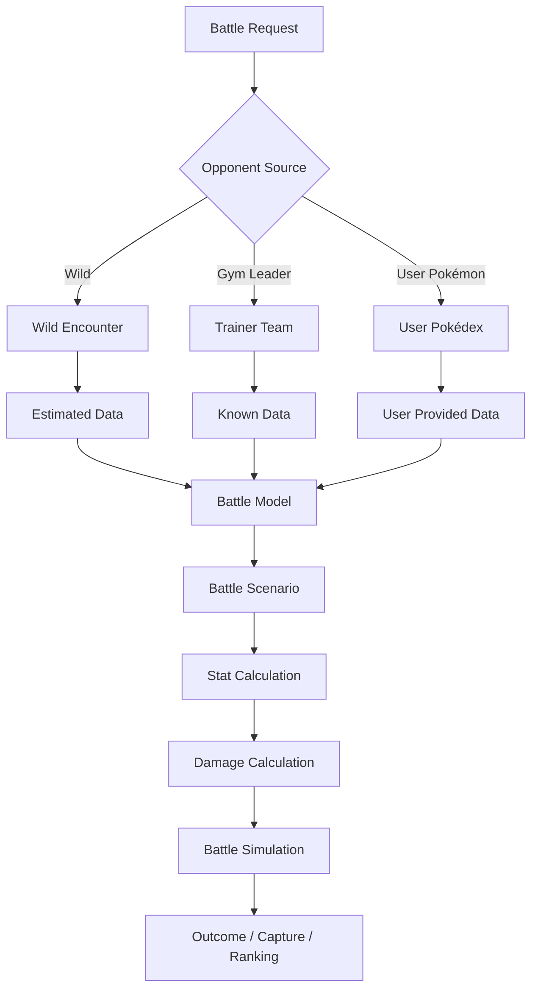

# Roadmap — Evoluções futuras

Registra possíveis evoluções do PokeBattle Predictor. **Nada aqui faz parte da V1.**

> Princípio: as funcionalidades futuras devem aumentar a precisão da simulação sem transformar o projeto em um sistema excessivamente complexo antes de existir necessidade real.

## Visão por versão

```
V1  Wild Pokémon + Progression + Estimated Data + Battle Simulation + Top 5
 ↓
V2  User Pokédex + Real Movesets + Nature + IVs / EVs + Known User Data
 ↓
V3  Trainer Battles + Gym Leaders + Known Teams + Known Movesets
 ↓
V4  Advanced Battle Simulation + Turn-by-turn + Multiple Pokémon + Strategy
 ↓
V5  Multiple Generations
```

---

## V2 — Pokédex personalizada

Permitir que o usuário cadastre seus próprios Pokémon e substitua dados estimados pelos reais.

```
UserPokemon
├── Pokémon, Nickname, Level
├── Nature, Ability
├── IVs, EVs
├── Moveset
└── Held Item
```

O usuário informa só o que conhece; o restante continua vindo de estimativas e cenários.

```
Charizard Lv. 42 · Nature: Adamant
Moves: Flamethrower, Fly, Slash, Dragon Claw
```

A pergunta muda de *"qual Pokémon eu consigo encontrar?"* para *"qual dos Pokémon que eu realmente tenho é melhor para essa batalha?"*.

Itens previstos:
- Banco de dados da Pokédex do usuário, ligado à autenticação
- Ao cadastrar um Pokémon, sugerir movimentos por nível via PokeAPI (`move_learn_method = level-up` e `level_learned_at <= nível`)
- Moveset editável, inclusive o nome do Pokémon
- Auditoria das ações sobre a Pokédex (criação, edição, remoção)

### Hierarquia de confiabilidade dos dados

Diferenciar a origem de cada informação usada na simulação:

```
Known          → ex.: moveset de Gym Leader
UserProvided   → ex.: nível informado pelo usuário
Estimated      → ex.: IV de Pokémon selvagem
```

Assim, os cenários variam **apenas** o que é realmente desconhecido.

### BattleParticipant

Modelo único para qualquer lado da batalha, para não criar um simulador por tipo de batalha:

```
BattleParticipant
├── Pokémon, Level, Nature, IVs, EVs
├── Ability, Moveset, Held Item
└── DataSource (Known | UserProvided | Estimated)
```

Serve para Wild, User, Trainer e Gym Leader Pokémon.

---

## V3 — Treinadores e Gym Leaders

Suporte a batalhas contra treinadores, começando por Gym Leaders. Como os times são conhecidos, o adversário pode ser tratado como determinístico, o que reduz a quantidade de estimativas.

```
Trainer
├── Team
├── Pokémon, Level, Moveset
└── Ability, Held Item
```

Análise Pokémon a Pokémon, não do time inteiro de uma vez.

### Trainer & Progression Prediction

Recomendar para batalhas contra NPCs considerando não só o que é forte contra o adversário, mas o que o jogador consegue obter naquele ponto da progressão:

```
Desafio conhecido → Time do treinador → Progressão atual → Fontes acessíveis
→ Pokémon obtíveis → Moves disponíveis → Simulação → Top 5
```

Perguntas que o sistema passa a responder:
- "Quais Pokémon consigo encontrar antes deste Gym?"
- "O que posso capturar para vencer este NPC?"
- "Quais opções consigo obter sem avançar além deste ponto?"

---

## V4 — Batalhas mais completas e estratégia de captura

Evoluir de comparação de matchup para simulação completa de batalha:

- troca de Pokémon e múltiplos Pokémon por lado
- ordem dos golpes e Speed
- efeitos de status, weather, abilities, held items
- condições específicas de batalha
- decisões estratégicas por turno
- habilidades que se fortalecem ou enfraquecem com tempo, amizade ou buffs (só quando descritas como golpe base na API)

### Estratégias de captura

Comparar estratégias, não só candidatos:

```
Strategy A: 1 HP  + sem status
Strategy B: 10 HP + Sleep
Strategy C: 1 HP  + Paralysis

HP restante → Capture Rate → Chance por bola → P(captura ≤ n bolas)
```

Identifica não só o melhor Pokémon para capturar, mas a melhor estratégia de captura.

### Fechamento da V4: sprites hospedados no projeto

Hoje o navegador carrega os sprites da FRLG de `raw.githubusercontent.com` (repositório `PokeAPI/sprites`, o mesmo link que a PokeAPI devolve). Se o GitHub estiver fora do ar ou bloqueado, o card mostra as iniciais.

Ao final da V4, hospedar os sprites junto com o app, como já acontece com os dados do jogo:
- o `DataImporter` baixa os 386 PNGs da FRLG uma vez;
- os PNGs são versionados e servidos pelo nginx do frontend (cerca de 1 a 2 MB);
- o `data-check` passa a cobrir os sprites;
- o `spriteUrl` em `frontend/src/models/labels.ts` aponta para o caminho local.

Resultado: nenhuma dependência externa em runtime.

---

## V5 — Outras gerações

Separar as regras por geração (Gen III, IV, V…), evitando misturar mecânicas em dano, captura, stats, habilidades, críticos e RNG. Pontos que mudam na prática: categoria física/especial passa a ser por golpe (Gen IV), crítico muda de 2x para 1.5x (Gen VI), Fairy aparece (Gen VI).

---

## Fluxo-alvo com múltiplas fontes de oponente


